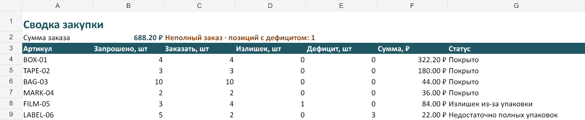

# Purchase Quote — закупка по прайсам поставщиков

[](https://github.com/SHUHER322/purchase_quote/actions/workflows/tests.yml)

Передайте заявку и прайсы поставщиков в Excel или CSV. Программа подберёт, у кого и сколько заказать, и соберёт одну книгу Excel со сводкой, заказами и списком позиций для уточнения.

## Как это выглядит



В демонстрационной заявке шесть артикулов и три вымышленных поставщика. Заказ стоит **688,20 ₽**. Трёх этикеток не хватает, а плёнки придёт на один рулон больше из-за фасовки. В книге можно посмотреть, из каких заказов сложилась сумма. [Открыть готовый отчёт](examples/demo/Отчёт.xlsx)

## Что умеет

| Задача закупщика | Как программа её решает |
|---|---|
| Сопоставить заявку с прайсами | Находит товары по артикулу. Текстовые коды с ведущими нулями сохраняются. |
| Покрыть заявку при ограниченных остатках | Покупает целыми упаковками и при необходимости делит позицию между поставщиками. |
| Выбрать предложение | Сначала покрывает максимум запрошенных штук, затем минимизирует стоимость купленных упаковок. При равной стоимости выбирает меньший излишек. |
| Подготовить заказы | На листе каждого выбранного поставщика показывает упаковки, штуки, цену за штуку и сумму. |
| Проверить отклонения | В сводке рядом с суммой показывает, полон ли заказ. Дефицит, отсутствующие артикулы и излишки собирает на листе «Требуют внимания». |

## Запуск на Windows

1. Установите Python 3.10 или новее. Скачайте архив **Source code (zip)** со [страницы релиза](https://github.com/SHUHER322/purchase_quote/releases/tag/v1.0.0) и распакуйте его.
2. Откройте в Проводнике папку с `purchase.py`, введите `powershell` в адресной строке и нажмите Enter.
3. Выполните две команды. Если Python запускается у вас командой `py`, замените `python` на `py` в обеих строках.

```powershell
python -m pip install -r requirements.txt
python purchase.py examples/demo/Заявка.csv examples/demo/Картонка.csv examples/demo/Пакетика.csv examples/demo/Рулоника.csv -o демо-заказ.xlsx
```

Откройте **демо-заказ.xlsx** в папке проекта. Суммы по поставщикам должны составить **108,00 ₽** у «Картонки», **364,20 ₽** у «Пакетики» и **216,00 ₽** у «Рулоники». Чтобы пересчитать заказ после изменения исходных файлов, закройте книгу в Excel и повторите вторую команду.

### Почему заказ распределился именно так

| Артикул | Решение | Сумма |
|---|---|---:|
| BOX-01 | Четыре коробки по 80,55 ₽ у второго поставщика, «Пакетики» | 322,20 ₽ |
| TAPE-02 | У «Картонки» лента дешевле, но закончилась. Три рулона поставит «Рулоника» | 180,00 ₽ |
| BAG-03 | Из десяти пакетов шесть поставит «Картонка», ещё четыре — «Пакетика» | 44,00 ₽ |
| MARK-04 | Два маркера по 18 ₽ обходятся дешевле упаковки из десяти по 7 ₽ за штуку | 36,00 ₽ |
| FILM-05 | Нужны три рулона. Одна упаковка содержит четыре, поэтому останется один лишний | 84,00 ₽ |
| LABEL-06 | Нужны пять этикеток. На складе три, фасовка по две, заказать можно две | 22,00 ₽ |

## Как подставить свои данные

Первым файлом передайте заявку, затем по одному прайсу каждого поставщика. Название файла без расширения станет названием поставщика. CSV и Excel можно сочетать. Путь к итоговой книге укажите после `-o`.

```powershell
python purchase.py "Мои закупки/Заявка.xlsx" "Мои закупки/Склад.csv" "Мои закупки/Оптовик.xlsx" -o "Заказ.xlsx"
```

Начните с [заявки Excel](examples/request.xlsx), [прайса Excel](examples/prices.xlsx) или [демонстрационных файлов с остатками и упаковками](examples/demo). В Excel данные должны быть на первом листе, заголовки — в первой строке. Для CSV используйте UTF-8 и разделитель `;`.

| Файл | Столбец | Что указывать |
|---|---|---|
| Оба | `артикул` | Уникальный код в пределах файла. Для кодов вроде `001` задайте текстовый формат ячейки до ввода. |
| Заявка | `количество` | Запрошенное количество в штуках, целое положительное число. |
| Прайс | `цена, ₽/шт` или `цена` | Рубли за одну штуку, до двух знаков после точки или запятой. |
| Прайс | `остаток, шт` | Доступное количество штук, включая неполную упаковку. Ноль означает, что товар закончился. Без этого столбца запас считается неограниченным. |
| Прайс | `штук в упаковке` | Размер неделимой упаковки, целое положительное число. Без этого столбца товар продаётся поштучно. |

Если указали столбец остатка или фасовки, заполните его для каждой строки. Для быстрого расчёта в терминале по-прежнему работает команда для двух CSV:

```powershell
python purchase.py examples/request.csv examples/prices.csv
```

## Как устроено

| Путь | Назначение |
|---|---|
| [purchase.py](purchase.py) | Чтение и проверка заявки и прайсов, запуск из командной строки |
| [allocation.py](allocation.py) | Распределение целых упаковок по поставщикам |
| [excel_report.py](excel_report.py) | Запись сводки, заказов и позиций для проверки в Excel |
| [examples/demo](examples/demo) | Заявка, три прайса и готовый отчёт |
| [tests](tests) | Проверки ввода, выбора поставщиков и сверка сумм в сформированной книге |

Тесты запускаются командой `python -m unittest discover -s tests -v`. GitHub Actions выполняет их на Python 3.10 и 3.14.
